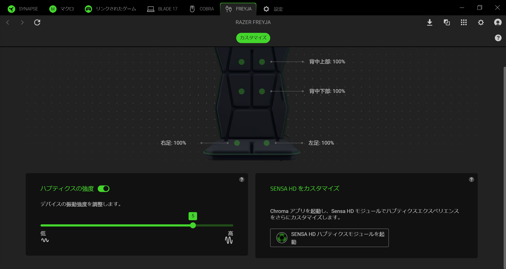
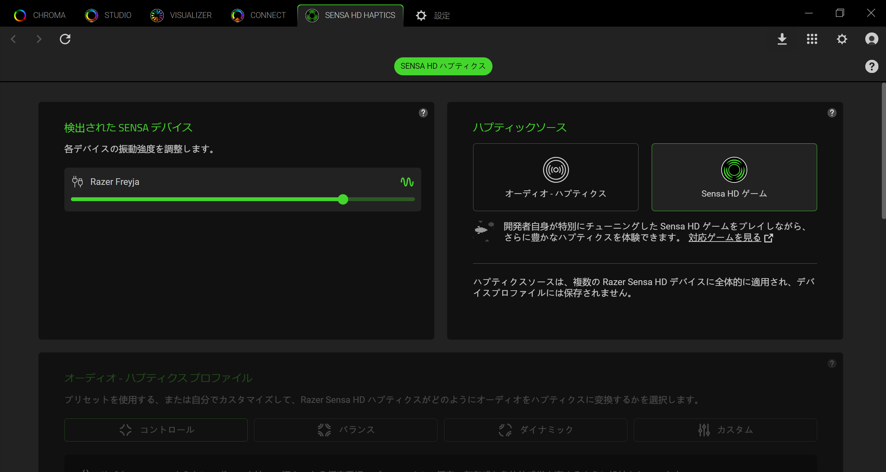
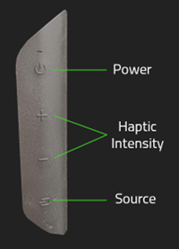
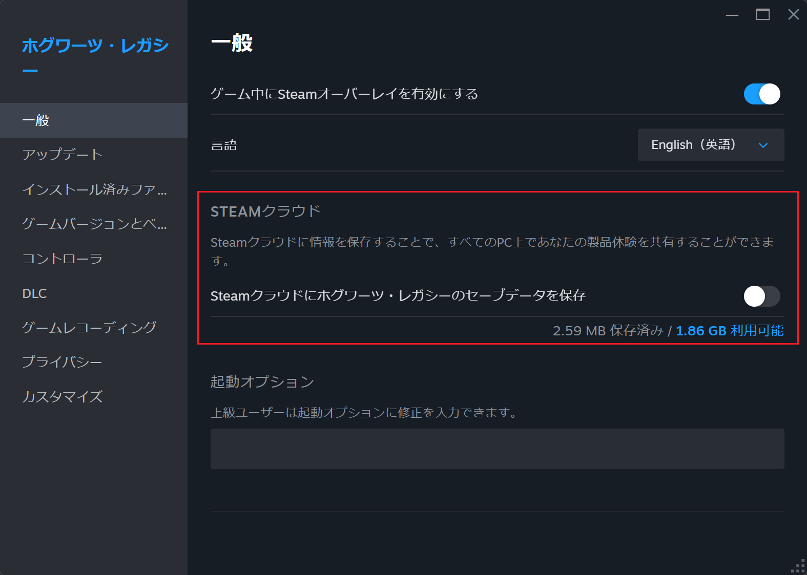
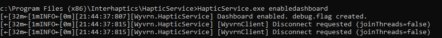
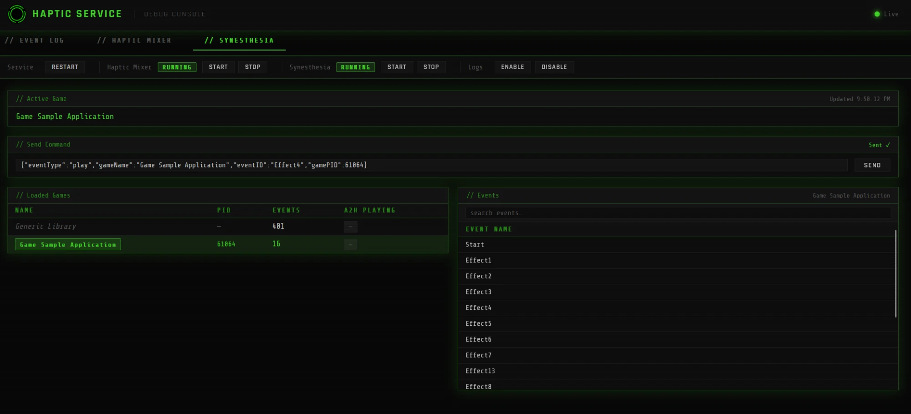
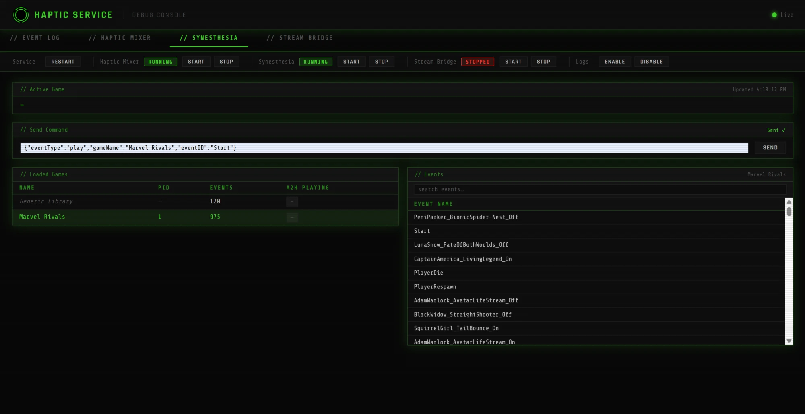
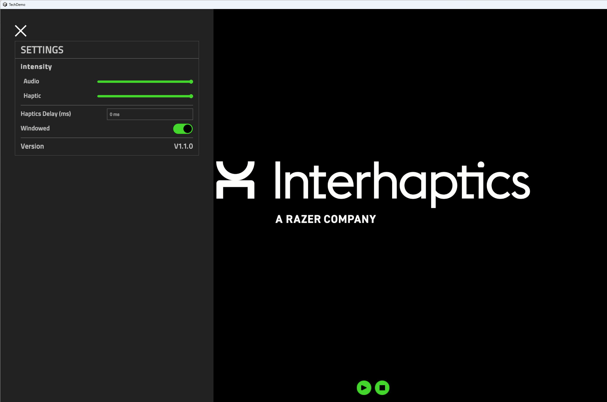

# Razer Sensa DevKit

Razer Sensa DevKit を使うと、WYVRN SDK を通じて Sensa HD Haptics をゲームに統合し、テストできます。

## 目次
1. [キットの内容](#キットの内容)
2. [ハードウェアとドライバーのセットアップ](#ハードウェアとドライバーのセットアップ)
    1. [Razer Synapse 4](#razer-synapse-4)
    2. [Razer Freyja](#razer-freyja)
    3. [Razer Wolverine V3 Pro](#razer-wolverine-v3-pro)
3. [WYVRN SDK の統合](#wyvrn-sdk-の統合)
    1. [仕組み](#仕組み)
    2. [ハプティックフォルダーの配置](#ハプティックフォルダーの配置)
    3. [サンプルと参考用コンテンツ](#サンプルと参考用コンテンツ)
    4. [ゲーム内でのテスト](#ゲーム内でのテスト)
4. [ショーケースゲーム（Hogwarts Legacy / Marvel Rivals）](#showcase-games)
5. [Haptic Service Dashboard（デバッグ）](#haptic-service-dashboardデバッグ)
6. [技術デモ](#技術デモ)

---

## キットの内容

- ハードウェア:
  - Razer Kraken V4 Pro（開発キット版、ベースステーションなし）
  - Razer Freyja ハプティッククッション（市販品）
  - Razer Wolverine V3 Pro コントローラー（市販品）[在庫状況による]
  - Razer Chroma RGB デバイス（キーボード、マウス、マウスパッド）[在庫状況による]
- ドライバー: Razer Synapse 4（`Drivers/`）
- コンテンツ:
  - `Apps/Synesthesia/HapticFolders`: サンプルおよび参考用のハプティックフォルダー（[サンプルと参考用コンテンツ](#サンプルと参考用コンテンツ)を参照）
  - `Apps/TechDemo`: Sensa 技術デモ

## ハードウェアとドライバーのセットアップ

### Razer Synapse 4

1. Synapse 4 インストーラー（`Drivers/RazerSynapseInstaller.exe`）を実行します。最新バージョンは https://www.razer.com/synapse-4 からも入手できます。
2. セットアップの途中で、**Chroma** オプションにチェックを入れます。Chroma は必須です。WYVRN SDK とハプティックサービスは、Chroma と一緒にインストールされるためです。
3. Razer ID でサインインするか、ID を新規作成するか、ゲストとして続行します。再起動を求められた場合は、PC を再起動します。
4. Synapse 4 を開き、**Razer Freyja / Wolverine V3 Pro** または **Kraken V4 Pro** タブに移動して、**Launch Sensa HD Haptics** を押します。
5. **Haptic Source** が **Sensa HD Games** になっていることを確認します。*Audio-to-Haptics* になっている場合は切り替えます。




### Razer Freyja

- 電源アダプターをコンセントに差し込み、ケーブルを Freyja に接続します。
- 電源ボタンを押して、電源を入れます。
- USB ドングルを PC に接続します。接続時は、LED が**緑色に点灯**している必要があります。



| ボタン | 機能 |
|---|---|
| Power | デバイスの電源のオン/オフ |
| Haptic Intensity | 全体のハプティック強度: レベル 1（低）～ 6（高） |
| Source | USB ドングル（緑）または Bluetooth（青、現段階では非対応） |

ライトが緑色に点滅している場合は、ドングルを別の USB ポートに差し替えてください。青色（点滅または点灯）の場合、デバイスは Bluetooth モードになっています。**Source** を押して、2.4 GHz USB ドングルに戻してください。

### Razer Wolverine V3 Pro

1. [Razer Wolverine V3 Pro Firmware Updater](https://mysupport.razer.com/app/answers/detail/a_id/14630/~/razer-wolverine-v3-pro-firmware-updater-%7C-rz06-0520) を使用して、ファームウェアを **v2.02 以上**に更新します。
2. USB ドングルまたはケーブルを接続し、Xbox ボタンでコントローラーの電源を入れます。
3. **o + Menu + A** を 2 秒間長押しして **PC モード**に切り替えます。Sensa HD Haptics は PC モードでのみ動作し、Xbox モードでは動作しません。

## WYVRN SDK の統合

SDK と設定に関する完全なドキュメント: https://doc.wyvrn.com/ja/docs/wyvrn-sdk/wyvrn-configuration/haptics/

### 仕組み

ゲームがハプティックデータをストリーミングすることはありません。ゲームは WYVRN SDK を通じて**イベント**を通知します。Haptic Service は、ゲームごとの設定に従って、対応するハプティック効果を接続中の Sensa デバイスで再生します。

1. ゲームは自身を Chroma アプリとして登録し、WYVRN SDK（`CoreSetEventName`）を通じてイベント名を送信します。
2. Haptic Service は、ゲームの `Wyvrn.config` でそのイベントを検索します。
3. この設定ファイルでは、イベントが 1 つ以上のハプティック効果ファイル（`.haps`）と対象のボディグループにマッピングされています。サービスは、それらをデバイス上でレンダリングします。

留意点:

- **Chroma アプリの状態:** Synapse の Chroma Apps リストでゲームがオンになっている必要があります。Chroma とハプティクスを駆動できるアプリは一度に 1 つだけです（リストの一番上にあるアプリ）。
- **ボディグループ:** 「all」を使わず、グループを明示的に指定してください。Chest / Waist / Hand / Leg は Freyja とコントローラーに対応し、Head は Kraken に対応します。
- **更新レート:** ハプティック出力は約 33 ms（30 fps）に量子化されます。それより細かい間隔でイベントを送信しても、効果はありません。
- **Audio-to-Haptics:** ソースを **Sensa HD Games** にする必要があります（[Synapse のセットアップ](#razer-synapse-4)を参照）。

### ハプティックフォルダーの配置

ゲームごとに、アプリタイトルと同じ名前のフォルダーがあります。このフォルダーには、そのゲームの `Wyvrn.config` と `.haps` ファイルが入っています。サービスは、これらのファイルを次の場所から読み込みます。

```
C:\Program Files (x86)\Interhaptics\HapticFolders\<App Title>\
```

フォルダーをこの場所にコピーしてください。登録の手順は別途必要ありません。ファイルを変更したら、[ダッシュボード](#haptic-service-dashboardデバッグ)から Haptic Mixer（またはサービス）を再起動して、変更を反映させてください。

### サンプルと参考用コンテンツ

`Apps/Synesthesia/HapticFolders` には、Chroma に同梱されているハプティックフォルダーが入っています。テンプレートとして利用できます。

- **Game Sample Application:** WYVRN 開発者向けの最小限の参考用設定です。まずはここから始めてください。
- **GenericEvent:** 120 種類の既製イベント（`@Pistol`、`@Jump`、`@DamageNormal`、`@Engine_Start` など）を収めたライブラリです。どのゲームでも、独自のハプティック効果を作成せずに使用できます。カテゴリ別の完全な一覧は、`GenericEvent/Readme.md` を参照してください。
- リリース済みゲームのフォルダー（Hogwarts Legacy、Marvel Rivals、Borderlands 4 など）。実際のタイトルがイベントをハプティック効果にどのようにマッピングしているかを確認できます。

Razer Chroma がインストールされていれば、最新バージョンは `C:\Program Files (x86)\Interhaptics\HapticFolders` にあります。

### ゲーム内でのテスト

1. Sensa デバイスを接続し、[Synapse のセットアップ](#razer-synapse-4)を完了します。
2. Chroma Apps リストでゲームを有効にします。
3. 上記の説明に従って、ゲームのハプティックフォルダーを配置します。
4. ゲームを起動し、イベントを発生させます。
5. [Haptic Service Dashboard](#haptic-service-dashboardデバッグ) を使用して、イベントが届いていること、ハプティック効果が再生されていること、デバイスが検出されていることを確認します。

すぐに試せる参考用のゲームは、[ショーケースゲーム](#showcase-games)を参照してください。

## ショーケースゲーム（Hogwarts Legacy / Marvel Rivals） <a name="showcase-games"></a>

Chroma Sensa 対応ゲームで Sensa ハプティクスをテストします。以下の手順は Hogwarts Legacy（ホグワーツ・レガシー）を例にしていますが、https://www.razer.com/chroma-workshop#--sensa-games のリストに掲載されているどのゲームにも適用できます。たとえば、Marvel Rivals（マーベル・ライバルズ）、Final Fantasy XVI（ファイナルファンタジー XVI）、Silent Hill 2（サイレントヒル 2）、Sniper Elite: Resistance（スナイパーエリート：レジスタンス）、Frostpunk 2（フロストパンク 2）、Symphonia（シンフォニア）などです。

1. ゲームの PC 版（Steam/Epic）をインストールします。
2. Razer Sensa ハプティックデバイスを接続します。
3. ゲームが Chroma App としてオンになっていることを確認します。
4. Razer Synapse 4 を開き、Razer Freyja / Kraken V4 Pro タブに移動して、**Launch Sensa HD Haptics** を押します。**Haptic Source** が **Sensa HD Games** になっていること（Audio-to-Haptics ではないこと）を確認します。


5. ゲームを起動します。

再生されるハプティックイベントをリアルタイムで確認するには、[Haptic Service Dashboard](#haptic-service-dashboardデバッグ) を有効にし、プレイ中は **Event Log** タブと **Events** タブを開いたままにしてください。カスタムハプティックフォルダーを試すには、フォルダーを `C:\Program Files (x86)\Interhaptics\HapticFolders\<App Title>\` にコピーし（[ハプティックフォルダーの配置](#ハプティックフォルダーの配置)を参照）、ゲームを起動する前にダッシュボードから Haptic Mixer を再起動してください。

### Hogwarts Legacy のセーブファイル

このゲームでは、すべてのイベントにハプティクスが実装されています。Hogwarts Legacy をプレイしたことがない場合は、付属のセーブファイル（リポジトリ内の `Apps/Synesthesia/HogwartsLegacySaveGame.zip`）を次の手順で導入してください。

1. Steam/Epic アカウントからゲームを起動し、Hogwarts の手紙が表示されたらゲームを終了します。
2. Steam でゲームを右クリックし、Hogwarts Legacy のセーブデータについて Steam Cloud を無効にします（下の画像を参照）。



3. ファイルエクスプローラーで `C:\Users\<Your USERNAME>\AppData\Local\Hogwarts Legacy\Saved\SaveGames` に移動します。
4. バックアップとして、その場所にあるすべてのフォルダー（数字の名前が付いています）を複製します。
5. 元のフォルダーの内容を削除し、空になったフォルダーに `HogwartsLegacySaveGame.zip` を解凍します。

## Haptic Service Dashboard（デバッグ）

Haptic Service Dashboard は、実行中の Haptic Service を監視・制御するための組み込みのローカル Web インターフェースです。どのプログラムがハプティック出力を生成しているか、どのデバイスが接続されているかを表示します。また、ボリュームを調整したり、イベントを手動でトリガーしたり、サービスログをリアルタイムで監視したりできます。

> **診断専用のツールです。** ダッシュボードやこのセクションをエンドユーザーに提供しないでください。

### ダッシュボードの有効化

**管理者権限**のコマンドプロンプトで、`HapticService.exe` があるフォルダー（`C:\Program Files (x86)\Interhaptics\HapticService`）から次のコマンドを実行します。

```
HapticService.exe enabledashboard
```



変更を反映するため、Haptic Service を再起動します。

```
HapticService.exe restart
```

次に、**http://localhost:8787** を開きます。ダッシュボードを無効にするには、次のコマンドを実行します。

```
HapticService.exe disabledashboard
```

ダッシュボードは `127.0.0.1` にのみバインドされ、他のマシンからはアクセスできません。

**カスタムポート（任意）:** `HapticService.exe` と同じ場所に `debug.flag` を作成し、`port=<1-65535>` の 1 行だけを記述します。その後、`HapticService.exe restart` でサービスを再起動します。

### レイアウト

- **ヘッダー:** 接続ステータス（Live / Connecting… / Reconnecting…）。
- **コントロールバー:** 開始/停止/再起動の操作。
- **タブ:** Event Log、Haptic Mixer、Events（イベントエンジン）。

テーブルは、表示されている間、2 秒ごとに更新されます。

| コントロールグループ | 操作 |
|---|---|
| Service | **Restart** で HapticService Windows サービスを再起動します（確認を求められます。ダッシュボードは自動的に再接続します）。 |
| Haptic Mixer | **Start / Stop** でミキサー（デバイス検出、コマンド処理）を開始/停止します。 |
| Event engine | **Start / Stop** でイベント駆動のハプティックレンダリングを開始/停止します。 |
| Logs | **Enable / Disable** で、再起動せずに詳細ログを有効/無効にします。 |

### Event Log タブ

サービスが記録するすべてのログをリアルタイムで表示し、フィルタリングもできます。イベントが再生されないときに最初に確認すべき場所です。

| コントロール | 用途 |
|---|---|
| Level | INFO、WARN、ERROR でフィルタリングします。 |
| Tags | サブシステムタグ（Mixer、Device など）でフィルタリングします。「No tag」はタグのない行に一致します。 |
| Search | メッセージを部分文字列で検索します（大文字と小文字は区別しません）。 |
| Auto-scroll | 最新のメッセージに追従します。 |
| Export TXT | 表示中の行を `haptic-service-<timestamp>.txt` に保存します。バグレポートに添付してください。 |
| Clear | 表示されているログを消去します（サービスには影響しません）。 |

画面には最新の 500 行が保持されます。サービスは 5,000 行を保持し、ダッシュボードの再接続時に再送します。

### Haptic Mixer タブ

- **タイプ別ボリューム（0-100 %）:** *Audio to Haptics*、*Events*（ゲームイベントでトリガーされるハプティクス）、*Native*（WYVRN SDK と直接統合しているタイトル）のマスタースライダーです。
- **Programs:** ハプティックコマンドを生成しているプログラムごとに、1 行ずつ表示されます。各行には、名前、PID、ステータス（ACTIVE = フォアグラウンド、それ以外は IDLE）、ミュートの切り替え、プログラムごとのボリューム、**Last Buffer**（最後に送信してからの経過時間）が表示されます。Last Buffer を見ると、プログラムが無音なのがミュートのためなのか、送信を停止したためなのかを判別できます。
- **Devices:** 検出されたハプティックデバイスが、名前、ID、デバイスごとのボリュームとともに表示されます。**Report** ボタンでは、完全なデバイスレポート（JSON）を表示できます。このレポートは、サポートへの問い合わせ時に役立ちます。

### Events タブ

このタブは、ダッシュボード上では **Synesthesia** と表示されます。



イベントエンジンが読み込んでいる内容を表示します。また、ゲームを実行せずにイベントを発火できます。

- **Active game:** イベントテーブルが現在読み込まれているゲームです。
- **Loaded games:** メモリ上の各ゲーム定義と、組み込みの **Generic Library** です。それぞれの PID、イベント数、audio-to-haptics ストリームが再生中かどうかが表示されます。行をクリックすると、その行のイベントが一覧表示されます。
- **Events list:** 検索できます。イベントをクリックすると、そのイベントが Send Command ボックスにあらかじめ入力されます。
- **Send Command:** JSON ペイロードをエンジンに送信します。次に例を示します。

```json
{"eventType":"play","gameName":"MyGame","eventID":"footstep"}
```

ショーケースゲームのイベントは、そのゲームを実行していなくてもテストできます。以下の例では、Marvel Rivals の `Start` イベントを送信しています。



| フィールド | 必須 | 説明 |
|---|---|---|
| `eventType` | はい | イベントのアクション: `play`、`stop`、`load` など |
| `gameName` | いいえ | 対象のゲーム（汎用イベントの場合は省略） |
| `eventID` | いいえ | Events list に表示されているイベント識別子 |
| `gamePID` | いいえ | 対象を、実行中の特定のゲームインスタンスに限定 |

Enter キーまたは **Send** を押します。ステータスラベルには、成功した旨、またはサービスからのエラーが表示されます。この方法なら、`Wyvrn.config` 内のイベントが正しいハプティック効果に関連付けられているかどうかを、最も手早く確認できます。

### トラブルシューティング

| 症状 | 考えられる原因 / 対処方法 |
|---|---|
| ダッシュボードが `localhost:8787` で読み込まれない | ダッシュボードが有効になっていないか、`debug.flag` でポートが上書きされています。管理者権限で `HapticService.exe enabledashboard` を実行し、続けて `HapticService.exe restart` を実行してから、再度確認してください。 |
| ヘッダーに *Reconnecting…* と表示される | サービスが停止しているか、再起動中です。解消しない場合は、`services.msc` で HapticService を確認してください。 |
| テーブルに *Loading…* / *Failed to fetch* と表示される | ポーリングがタイムアウトしました。通常は次回の更新時に回復します。 |
| ボリュームスライダーが元の値に戻る | サービスまたは別のクライアントが値を変更しました。実際の現在値が優先されます。 |
| Event Log が空 | ログが無効になっています。Logs グループの **Enable** を押してください。 |
| Devices テーブルにデバイスが表示されない | デバイスが接続され、電源が入っていることを確認してから、Haptic Mixer を再起動してください。それでも表示されない場合は、ログをエクスポートしてサポートチケットを作成してください。 |
| ゲームイベントで何も起こらない | ゲームが Chroma Apps で有効になっていること、フォルダーが `HapticFolders\<App Title>\` にあること、イベントが Events タブに表示されていること、Event Log にそのイベントに関する WARN/ERROR がないことを確認してください。Send Command でイベントを試してください。 |

### セキュリティに関する注意事項

- ダッシュボードは、設計上ループバック（127.0.0.1）でのみ待ち受けます。
- 本番環境では、リバースプロキシ、VPN、トンネルを介して公開しないでください。
- 実際に必要としていない本番マシンでは、無効にしてください。

## 技術デモ

ハードウェアのセットアップを一通り確認するための、任意の手順です（`Apps/TechDemo`）。

1. `TechDemo_V[x.x.x].zip` を任意のフォルダーに解凍します。
2. 解凍したフォルダーから TechDemo アプリを起動します。
3. Play を押します。



[目次に戻る](#目次)
